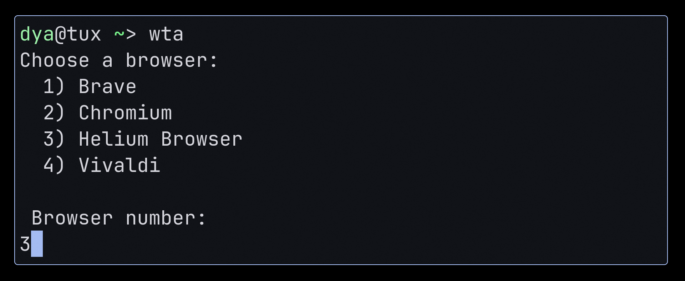
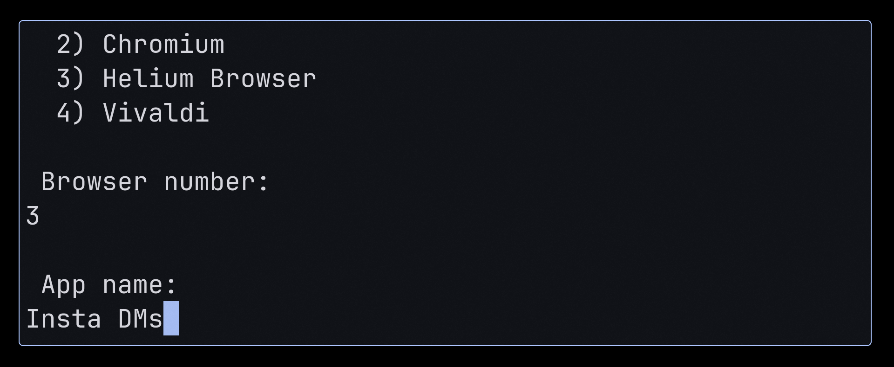
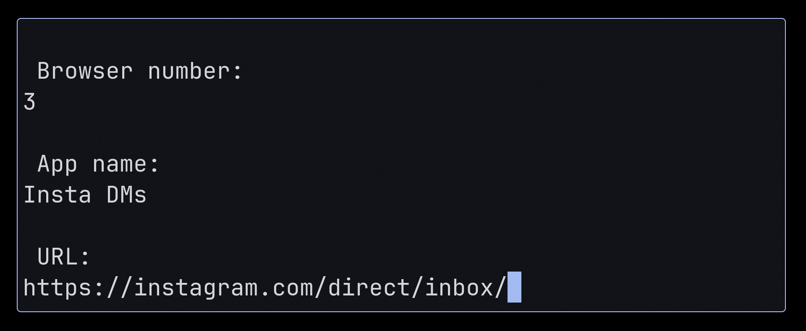
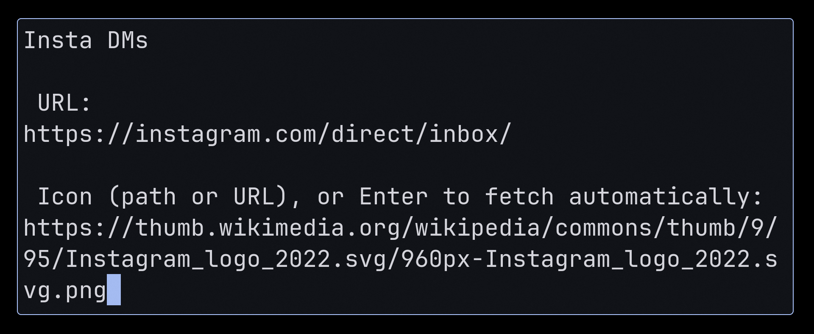

# WTA - Website To App

سكربت bash بسيط يحوّل أي موقع ويب إلى تطبيق مستقل على سطح مكتب لينكس، مع أيقونة قابلة للتخصيص تظهر في قائمة التطبيقات.

## المتطلبات

- curl
- ImageMagick
- Chromium أو أي متصفح مبني عليه مثل Brave, Vivaldi ... `المهم يدعم --app`

### تثبيت المتطلبات

**Arch**
```bash
sudo pacman -S curl imagemagick chromium
```

**Fedora**
```bash
sudo dnf install curl ImageMagick chromium
```

**Debian / Ubuntu**
```bash
sudo apt install curl imagemagick chromium
```

## التثبيت

```bash
git clone https://github.com/0xdya/wta.git
cd wta
chmod +x install.sh
./install.sh
```

## الاستخدام

### الوضع التفاعلي

```bash
wta
```

1. اختر المتصفح.
   
2. اكتب اسم التطبيق.
   
3. اكتب رابط الموقع.
   
4. حدّد مسار الأيقونة (اختياري).
   

### الاستخدام السريع

```bash
wta AppName URL [icon]
```

لتحديد المتصفح:

```bash
WTA_BROWSER=brave wta AppName URL [icon]
```

## أوامر أخرى

| الأمر | الوظيفة |
|---|---|
| `wta -l` | عرض التطبيقات التي أنشأتها |
| `wta -u` | تحديث الأداة |
| `wta -r youtube` | حذف تطبيق محدد |

## إزالة الأداة

```bash
./uninstall.sh
```

> احذف تطبيقاتك أولًا بـ `wta -r` قبل إزالة الأداة.